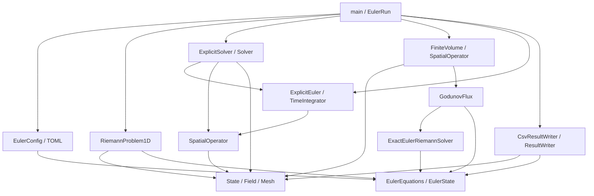

# Часть 2. Проект газодинамического комплекса

Документ отвечает на пункты 2.1–2.10 задания `prac15`. Основа комплекса уже работает: одномерные уравнения Эйлера для идеального газа, метод Годунова первого порядка, точный решатель Римана и явный Эйлер по времени. Расчёт последовательный.

HLL/HLLC/Роу, повышенный порядок, двумерная газодинамика и MPI/OpenMP относятся к развитию проекта. Ниже для них указан способ включения в существующую структуру. Пустые заголовки в дереве обозначают места расширения, а не готовые реализации.

## 2.1. Модули и зависимости

| Модуль | Реализация и назначение |
| --- | --- |
| Газ и переменные | `EulerState.hpp`, `EulerEquations`: примитивное состояние, консервативное состояние, уравнение состояния, преобразования, физический поток и скорость звука |
| Локальная задача Римана | `ExactEulerRiemannSolver`: решение одного разрыва и отбор состояния по автомодельной координате; сетка и файлы ему не нужны |
| Поток на грани | `GodunovFlux`: вызывает точный решатель, отбирает состояние на неподвижной грани и возвращает поток вместе с максимальной скоростью сигнала |
| Сетка и поля | `Mesh`, `CartesianMesh`, `Field`, `State`: геометрия, массивы компонент и время расчёта |
| Начальные данные | `RiemannProblem1D`: переводит два состояния из конфига в средние консервативные значения по ячейкам |
| Границы | Сейчас обе границы `transmissive` обрабатываются в `FiniteVolume`; общий `BoundaryCondition.hpp` пока пуст |
| Пространственная схема и CFL | `SpatialOperator`, `FiniteVolume`: потоки на гранях, правые части для ячеек и допустимый шаг времени |
| Интегратор и расчёт | `TimeIntegrator`, `ExplicitEuler`, `Solver`, `ExplicitSolver`: один шаг, проверка нового состояния, цикл до конечного времени |
| Ввод и управление | `EulerConfig`, `EulerRun`, `main.cpp`: чтение TOML, создание объектов и запуск |
| Вывод | `ResultWriter`, `CsvResultWriter`: запись состояния через наблюдатель, переданный в `Solver::run` |
| Постобработка | `plot_toro.py`: чтение CSV, графики и отчёт; численный решатель не вызывается |
| Проверки | `tests/`, пять общих TOML в `configs/`; тесты связывают модули, но модули от тестов не зависят |

Зависимости рабочего газодинамического пути; стрелка направлена от использующего модуля к используемому:



`ExplicitSolver` получает функцию-наблюдатель, поэтому от CSV и конкретного writer он не зависит. Текстовый вывод можно заменить, не меняя цикл расчёта. Чтение TOML также остаётся в приложении: библиотека `numerics` получает готовые числа и объекты.

Общий интерфейс полного расчёта — `Solver<Dim>` с методами `state()`, `maxTimeStep()`, `step(dt)` и `run(endTime, observer, options)`. Это отдельный уровень по отношению к локальному решателю Римана: один управляет эволюцией всего состояния, другой обрабатывает пару состояний на одной грани.

## 2.2. Единый интерфейс решателей Римана

Сейчас `FiniteVolume` содержит конкретный `GodunovFlux`, а тот — `ExactEulerRiemannSolver`. Выбор по конфигу ограничен `godunov_exact`. Для смены решателя без изменения схемы нужен один дополнительный контракт — численный поток на грани:

```cpp
#include "numerics/methods/fluxes/GodunovFlux.hpp"
#include <memory>
#include <string>

struct FaceFluxResult {
  EulerFlux flux;
  double signalSpeed;
};

class RiemannFlux {
 public:
  virtual ~RiemannFlux() = default;
  virtual FaceFluxResult flux(const EulerPrimitiveState& left,
                              const EulerPrimitiveState& right) const = 0;
};

class ExactFlux final : public RiemannFlux {
 public:
  ExactFlux(double gamma, ExactRiemannOptions options = {})
      : exact_(gamma, options) {}
  FaceFluxResult flux(const EulerPrimitiveState& left,
                      const EulerPrimitiveState& right) const override {
    const auto result = exact_(left, right);
    return {result.flux, result.signalSpeed};
  }
 private:
  GodunovFlux exact_;
};

// Фабрика располагается в приложении, рядом с EulerRun.
std::unique_ptr<RiemannFlux> makeRiemannFlux(
    const std::string& name, double gamma, ExactRiemannOptions options);
```

Это **проект интерфейса**, пока не добавленный в исходники. Вход — физически допустимые состояния с одинаковым γ; выход — поток слева направо и конечная неотрицательная оценка максимальной скорости сигнала для CFL. Параметры хранятся в объекте, вызов не меняет общих данных. Недопустимые состояния и невозможность получить поток сообщаются исключением с последующим добавлением номера грани и времени на уровне схемы.

Схеме не требуется полная структура точного решения: HLL, например, не строит точные вееры. Поэтому общий контракт возвращает поток. Существующие `solve()` и `sample()` точного решателя сохраняются для диагностики и тестов.

Однократный переход: `FiniteVolume` получает `RiemannFlux` через конструктор, `EulerConfig` хранит имя потока, а `EulerRun` вызывает фабрику. Вместо проверки единственного имени парсер проверяет имя по списку зарегистрированных реализаций. После этого добавление HLL состоит из четырёх действий:

1. Добавить `HllFlux.hpp/.cpp`, реализующий тот же интерфейс и оценку скоростей крайних волн.
2. Зарегистрировать имя `hll` в фабрике и включить исходник в `numerics` через CMake.
3. Проверить равные состояния, ударные волны, разрежения и баланс потоков; для HLL задать собственные допуски к сеточному решению.
4. Указать `solver.flux = "hll"` в конфиге. `FiniteVolume` и `main.cpp` после указанного перехода менять не потребуется.

HLLC и Роу добавляются тем же путём. Для схем повышенного порядка реконструкция и ограничитель располагаются перед вызовом потока: меняются состояния на гранях, контракт потока сохраняется.

## 2.3. Данные, память и физические параметры

На сетке хранятся средние консервативные величины. Они позволяют использовать один поток для двух соседних ячеек и получать дискретный баланс массы, импульса и энергии.

```text
U = (ρ, ρu, ρE)
p = (γ − 1) · [ρE − (ρu)² / (2ρ)]
E = e + u²/2
```

Поле `energy` означает полную энергию **на единицу объёма**, а не удельную энергию. Примитивное состояние `(ρ, u, p)` восстанавливается через `EulerEquations` перед вычислением потока и вывода. Если начальный разрыв пересекает ячейку, `RiemannProblem1D` усредняет консервативные состояния с весами по длине частей ячейки.

`State<Dim>` содержит набор `Field<double, Dim>` и время. Каждый `Field` владеет непрерывным массивом одной компоненты: размещение полей — SoA, то есть отдельные массивы плотности, импульса и энергии. Это удобно для обхода одной компоненты, векторизации и упаковки граничных слоёв. В локальном вызове Римана используются маленькие структуры состояний. Упаковка SoA в такие структуры выполняется на грани и не меняет основного хранения.

Сетка хранится отдельно и должна жить дольше `State`, его полей и `FiniteVolume`. Поля могут обозначать `CellAverage`, `CellCenter` или `Node`; смена метки сама не выполняет интерполяцию. Газовая схема принимает только `CellAverage`. В 1D у N ячеек N+1 узлов. В многомерном индексе быстрее всего меняется координата 0.

Сейчас отдельных фиктивных ячеек нет: на внешней грани `FiniteVolume` подставляет состояние ближайшей внутренней ячейки с обеих сторон. В проекте MPI каждая подобласть будет хранить внутренние ячейки и отдельные граничные слои по каждой компоненте. Для первого порядка достаточно одного слоя; число слоёв задаётся требованиями реконструкции. Глобальный номер внутренней ячейки и индексы слоёв должны различаться; в физический CSV и интегралы слои не входят.

Все вещественные данные — `double`; CSV записывается с 17 значащими цифрами. γ, CFL и настройки точного решателя читаются в `EulerConfig` и явно передаются конструкторам, изменяемых глобальных параметров нет. Тесты Торо используют безразмерные величины. Автоматического перевода единиц код не делает; для размерного расчёта пользователь должен согласовать единицы всех входных величин.

`Mesh`, `Field` и `State` допускают несколько измерений. Газовые состояния, поток и `FiniteVolume` пока одномерные. Для 2D потребуются `(ρ, ρu, ρv, ρE)`, потоки по нормали к каждой грани и перенос поперечного импульса. При использовании 1D-решателя во вращённых координатах нужно учесть поперечную кинетическую энергию; одной замены `<1>` на `<2>` недостаточно.

## 2.4. Ввод данных

Газовое приложение читает TOML версии 2 через `EulerConfig` и общий заголовок `utils/toml.hpp`. Полный рабочий пример — [configs/toro_1.toml](../../configs/toro_1.toml):

```toml
# Toro 1: Sod. Начальные состояния постоянны на полуосях.
config_version = 2

[problem]
type = "euler_1d"

[parameters]
gamma = 1.4

[domain]
x = [0.0, 1.0]
t = [0.0, 0.25]

[grid]
cells = 200

[initials]
type = "riemann"
discontinuity = 0.5

[initials.left]
density = 1.0
velocity = 0.0
pressure = 1.0

[initials.right]
density = 0.125
velocity = 0.0
pressure = 0.1

[boundaries.left]
type = "transmissive"

[boundaries.right]
type = "transmissive"

[solver]
method = "finite_volume"
flux = "godunov_exact"
integrator = "explicit_euler"
cfl = 0.4

[solver.exact]
max_iterations = 100

[output]
directory = "results/toro_1"
format = "csv"
save_every = 10
fields = ["density", "momentum", "energy", "velocity", "pressure"]
```

`domain.t[1]` — конечное время `tout`. Шаг выбирается по CFL; начальный и конечный слои сохраняются всегда, промежуточные — через `output.save_every` принятых шагов. Произвольный список физических моментов вывода пока не поддержан. Предусмотренное расширение — `output.times = [0.0, 0.1, 0.25]`: отсортированные времена внутри `domain.t`, до ближайшего из них шаг укорачивается. Сейчас добавлять это поле в рабочий TOML нельзя: парсер отклоняет неизвестные поля.

Проверяются версия и типы полей, неизвестные имена, γ > 1, конечные значения, положительные плотность и давление, порядок границ области и времени, положительное число ячеек и представимый шаг сетки, расположение разрыва внутри области, `0 < CFL <= 0.5`, положительные допуски и лимиты итераций. Также проверяются поддерживаемые алгоритмы, типы границ и имена выводимых компонент без повторений. Вакуум и потеря физической допустимости выявляются численными модулями.

Ошибка содержит путь к полю, например `solver.cfl: must be in (0, 0.5]`; при ошибке расчёта добавляются время и номер ячейки или грани. CLI пишет ошибку в stderr и возвращает ненулевой код. Имеющиеся слои после сбоя не считаются завершённым расчётом.

Пути из TOML отсчитываются от его каталога, `--output-dir` — от текущего каталога запуска. Вывод направляется только в новую или пустую папку. Секция `[output]` необязательна; `--output-dir` включает вывод и при её отсутствии.

`utils/ConfigProcessor` — отдельный читатель волнового TOML v1 с формулами ExprTk. Газовое приложение его не вызывает: из `utils` оно использует только TOML-заголовок. Эти два формата не взаимозаменяемы.

## 2.5. Вывод и сведения о запуске

Существующий отладочный формат — `solution.csv` с колонками `time,cell,x` и выбранными физическими полями. Каждая строка соответствует одной внутренней ячейке и сохранённому времени; скорость и давление вычисляются из консервативных средних. Формат можно читать без специальной библиотеки, но для больших многомерных расчётов повторяющиеся координаты и текстовые числа дают лишний объём.

Для таких расчётов выбран будущий writer VTK XML ImageData: геометрия равномерной сетки задаётся началом, шагом и диапазоном индексов, поля — массивами `CellData`. Двоичные данные со сжатием уменьшают объём по сравнению с CSV; формат поддерживает разбиение на файлы подобластей. Расширения `.vti` и `.pvti` соответствуют последовательным и распределённым ImageData. [Описание формата VTK](https://docs.vtk.org/en/latest/vtk_file_formats/vtkxml_file_format.html).

| Файлы | Правило |
| --- | --- |
| `solution.csv`, `run.txt` | Текущий CLI, отдельный каталог для каждого запуска |
| `toro_1/` … `toro_5/` | Экспорты точных тестов: собственные CSV и копия `config.toml`; рисунки собираются в `plots/` |
| `solution_000010.vti` | Проект: номер сохранённого слоя с ведущими нулями; физическое время хранится отдельно |
| `solution_000010_rank0003.vti`, `solution_000010.pvti` | Проект MPI: данные процесса и общий файл со ссылками на части |
| `times.csv`, `input.toml` | Проект: соответствие номера слоя времени и точная копия входа |

Текущий `run.txt` содержит параметры задачи, сетки и алгоритмов, настройки точного решателя, количество сохранённых слоёв, статус и достигнутое время. Диагностика `riemann_iterations` и `riemann_pressure_change` относится к исходному разрыву, а не ко всем граням расчёта. После сбоя сохраняется отметка о неудаче и последнее принятое время.

Для воспроизводимости в проекте предусмотрены дополнительные поля `git_revision`, признак незакоммиченных изменений, `config_file`, `created_at` в UTC и копия `input.toml`. Сейчас CLI ещё не записывает ревизию, дату и копию входа; точный тест копирует свой конфиг отдельно. Новый VTK writer подключается через существующий `ResultWriter` и наблюдатель.

## 2.6. Структура, сборка и запуск

Используется C++17, CMake не ниже 3.16. Сборка и тесты проверены на Linux с GCC 13.3.0 и CMake 3.28.3. Проверка Clang пока не выполнена. Python нужен только для постобработки; её зависимости — NumPy и Matplotlib.

Дерево исходников; пути отсчитываются от корня репозитория `projectAlpha`. В группах файлов после имени указано назначение каждого элемента.

```text
projectAlpha/
├── .gitignore                         # исключения сборок и результатов
├── .clangd                            # настройка редактора C++
├── configs/
│   └── toro_1.toml … toro_5.toml       # пять наборов начальных и граничных данных
├── plot_toro.py                        # графики и отчёты по CSV
├── utils/
│   ├── toml.hpp                       # сторонний TOML-парсер
│   ├── exprtk.hpp, exprtk-LICENSE.txt  # формулы и лицензия ExprTk
│   ├── toml-processor.hpp/.cpp         # интерфейс и реализация волнового ввода v1
│   ├── math-expression.cpp            # вычисление выражений для волнового ввода
│   ├── test.toml                      # пример волнового конфига
│   ├── tests/toml-processor-test.cpp   # тест отдельного читателя
│   ├── README.md                      # использование utils
│   └── toml_config_spec.md            # спецификация волнового TOML
└── numerical-solver/
    ├── CMakeLists.txt                 # библиотеки, CLI, тесты и цель графиков
    ├── README.md                      # сборка и быстрый запуск
    ├── apps/solver-cli/
    │   ├── main.cpp                   # аргументы командной строки и код завершения
    │   ├── EulerRun.hpp/.cpp          # интерфейс и сборка газового расчёта
    │   └── config/EulerConfig.hpp/.cpp # типы настроек и разбор TOML v2
    ├── include/numerics/
    │   ├── core/
    │   │   ├── Mesh.hpp               # интерфейс сетки и CartesianMesh
    │   │   ├── Field.hpp              # массив одной компоненты и положение данных
    │   │   ├── State.hpp              # компоненты состояния и время
    │   │   └── BoundaryCondition.hpp  # заготовка граничных условий
    │   ├── models/
    │   │   ├── EulerState.hpp         # состояния, поток и доступ к полям Эйлера
    │   │   ├── EulerEquations.hpp     # физические операции идеального газа
    │   │   ├── Transport.hpp          # заготовка переноса
    │   │   ├── HeatEquation.hpp       # заготовка теплопроводности
    │   │   └── WaveEquation.hpp       # заготовка волновой модели
    │   ├── problems/RiemannProblem1D.hpp # начальный разрыв и его проекция на сетку
    │   ├── methods/
    │   │   ├── SpatialOperator.hpp    # интерфейс пространственной правой части и CFL
    │   │   ├── FiniteVolume.hpp       # схема Годунова в 1D и кэш потоков
    │   │   ├── Upwind.hpp             # заготовка противопоточной схемы
    │   │   ├── CentralDifference.hpp  # заготовка центральных разностей
    │   │   ├── fluxes/GodunovFlux.hpp # поток через точное решение Римана
    │   │   ├── fluxes/RusanovFlux.hpp # заготовка потока Русанова
    │   │   └── riemann/ExactEulerRiemannSolver.hpp # локальный точный решатель
    │   ├── integrators/
    │   │   ├── TimeIntegrator.hpp     # интерфейс временного шага
    │   │   ├── ExplicitEuler.hpp      # явный Эйлер
    │   │   ├── RungeKutta4.hpp        # заготовка RK4
    │   │   └── CentralWaveStepper.hpp # заготовка волнового интегратора
    │   ├── solvers/
    │   │   ├── Solver.hpp             # интерфейс полного расчёта и наблюдатель
    │   │   ├── ExplicitSolver.hpp     # управление явными шагами и остановкой
    │   │   └── LinearSolver.hpp       # заготовка линейного решателя
    │   ├── io/
    │   │   ├── ResultWriter.hpp       # интерфейс записи состояния
    │   │   └── CsvResultWriter.hpp    # газовый CSV writer
    │   └── parallel/
    │       ├── ExecutionMode.hpp      # заготовка выбора режима
    │       └── ParallelFor.hpp        # заготовка параллельных обходов
    ├── src/
    │   ├── models/EulerEquations.cpp  # реализация физики газа
    │   ├── problems/RiemannProblem1D.cpp # проекция начальных состояний
    │   ├── methods/FiniteVolume.cpp   # границы, потоки, правые части и CFL
    │   ├── methods/riemann/ExactEulerRiemannSolver.cpp # реализация точного решения
    │   └── io/CsvResultWriter.cpp      # запись CSV
    ├── tests/
    │   ├── core-test.cpp              # геометрия и хранение полей
    │   ├── solver-test.cpp            # интегрирование и управление расчётом
    │   ├── finite-volume-test.cpp     # баланс, постоянное состояние, сгущение сетки
    │   ├── euler-config-test.cpp      # ввод газа и файловый вывод
    │   ├── riemann-test.cpp           # единственный C++ файл пяти тестов Торо
    │   ├── check-euler-output.cpp     # проверка результатов CLI
    │   ├── cli-test.cmake             # запуск CLI и проверяющей программы из CTest
    │   ├── test_plot_toro.py           # проверки Python-постобработки
    │   └── README.md                  # команды и допуски тестов
    └── docs/
        ├── architecture.md            # проект комплекса, пункты 2.1–2.10
        └── running.md                 # подробная инструкция пользователя
```

Шаблонные части реализованы в заголовках. В `src` находятся нешаблонные реализации. `build*/` и `results/` создаются при работе и не являются исходниками.

| Цель CMake | Состав и связи |
| --- | --- |
| `numerics` | Статическая библиотека: физика газа, начальная задача, точный решатель, конечные объёмы и CSV; публичные заголовки из `include/` |
| `config-reader` | Отдельная статическая библиотека: волновой парсер и выражения из `utils/` |
| `euler-app` | Статическая библиотека: газовый ввод и `EulerRun`; связывается с `numerics`, использует `toml.hpp`, не связывается с `config-reader` |
| `solver-cli` | Исполняемый файл, связывается с `euler-app` |
| `*-test`, `check-euler-output` | Исполняемые проверки; связываются с нужной библиотекой, регистрируются через CTest |
| `toro-plots` | Служебная цель: запускает `riemann-test`, затем Python; доступна при `BUILD_TESTING=ON` и найденном интерпретаторе |

Динамические библиотеки сейчас не используются. Разделение по модулям внутри `numerics` не требует отдельной библиотеки для каждого заголовка.

Все команды ниже выполняются из корня `projectAlpha`. Последовательная Release-сборка и запуск:

```sh
cmake -S numerical-solver -B build -DCMAKE_BUILD_TYPE=Release -DBUILD_TESTING=ON
cmake --build build
./build/solver-cli configs/toro_1.toml --output-dir results/sod-1
```

Отладочная сборка в отдельном каталоге:

```sh
cmake -S numerical-solver -B build-debug -DCMAKE_BUILD_TYPE=Debug -DCMAKE_EXPORT_COMPILE_COMMANDS=ON -DCMAKE_CXX_FLAGS="-Wall -Wextra -Wpedantic"
cmake --build build-debug
```

В проверенной конфигурации GCC CMake задаёт `-g` для Debug и `-O3 -DNDEBUG` для Release. Предупреждения в команде выше включаются явно; собственных флагов предупреждений в `CMakeLists.txt` нет. При смене компилятора создаётся новый каталог сборки. `.clangd` ожидает базу команд в `build/`; при использовании `build-debug/` путь в настройке редактора нужно согласовать.

На кластере сначала выбирают доступные модули компилятора и CMake. Названия зависят от установки; типичный порядок — `module avail`, затем `module load gcc cmake` и те же команды сборки. Пример задания **для текущей последовательной программы** в Slurm:

```bash
#!/bin/bash
#SBATCH --job-name=gas1d
#SBATCH --nodes=1
#SBATCH --ntasks=1
#SBATCH --cpus-per-task=1
#SBATCH --time=00:10:00
#SBATCH --output=slurm-%j.log
set -e
cd "$SLURM_SUBMIT_DIR"
srun ./build/solver-cli configs/toro_1.toml --output-dir "results/slurm-${SLURM_JOB_ID}"
```

Его сохраняют, например, как `run.slurm` и отправляют `sbatch run.slurm`; для конкретного кластера добавляют требуемые partition/account и загрузку модулей. Это пример, на кластере он не проверялся. Директивы и отправка соответствуют [документации Slurm](https://slurm.schedmd.com/sbatch.html).

## 2.7. Развитие до MPI и OpenMP

Распараллеливание в этой работе не реализуется. Заголовки `parallel/` пока пусты; ниже описано, что должно появиться в них и смежных модулях.

**MPI.** В 1D область делится на непрерывные диапазоны глобальных ячеек. Процесс владеет своим диапазоном и граничными слоями; модуль декомпозиции хранит соседей и отображение локальных индексов в глобальные. Модуль обмена из `parallel/` упаковывает компоненты полей, передаёт слои соседям и заполняет принятые данные. Физические края заполняет модуль граничных условий. Решатель Римана о MPI не знает.

Порядок шага первого порядка:

1. Заполнить физические границы и обменять граничные слои текущего состояния.
2. Вычислить потоки на гранях и локальное ограничение времени. На общей грани процессов использовать один порядок левого и правого состояния и одинаковые параметры потока.
3. Получить глобальный минимум допустимого шага через `MPI_Allreduce` с `MPI_MIN`, затем ограничить шаг конечным временем и ближайшим моментом вывода.
4. Обновить только внутренние ячейки, проверить физическую допустимость, согласовать успешность шага между процессами и принять состояние.
5. Вызвать распределённый вывод, если наступил нужный момент. Для многостадийной схемы обмен нужен перед каждой стадией, использующей соседние данные.

```text
dt_local = CFL · dx / max_face(signalSpeed)
dt_global = min_process(dt_local)
```

Для нескольких направлений CFL рассчитывает соответствующий пространственный оператор с учётом всех направлений. При ошибке одного процесса остальные должны получить общий признак отказа и завершиться согласованно, без ожидания несуществующего обмена.

**OpenMP.** При фиксированном состоянии каждая грань обрабатывается независимо. Точный решатель и `GodunovFlux` используют неизменные параметры и локальные временные данные. Массив результатов заранее выделяется; итерация записывает только свой `faces[i]`, а максимум скорости находится редукцией. Следующий цикл обновляет каждую ячейку по двум готовым потокам, без конкурентного прибавления в соседние ячейки. Ошибки собираются и обрабатываются после параллельного участка.

У текущего `FiniteVolume` есть изменяемый кэш: одновременные вызовы `prepare()` для одного экземпляра небезопасны. Перед включением OpenMP управление кэшем должно остаться вне параллельного обхода, а работа по граням — получить заранее подготовленные буферы. Это изменение пространственного оператора; локальный решатель переписывать не требуется.

SoA даёт последовательный доступ к компонентам, но многомерная грань не всегда непрерывна в памяти: такой слой явно упаковывается в буфер. При выводе каждый MPI-процесс записывает собственный `.vti` без фиктивных ячеек; процесс 0 после завершения записей создаёт `.pvti` и индекс времён. Одновременная запись всеми процессами в один `solution.csv` не предусматривается.

Проект подключения зависимостей CMake — **этих опций в текущей сборке ещё нет**:

```cmake
option(NUMERICS_USE_MPI "Enable MPI domain decomposition" OFF)
option(NUMERICS_USE_OPENMP "Enable OpenMP loops" OFF)
if(NUMERICS_USE_MPI)
  find_package(MPI REQUIRED COMPONENTS CXX)
  target_link_libraries(numerics PUBLIC MPI::MPI_CXX)
  target_compile_definitions(numerics PUBLIC NUMERICS_USE_MPI=1)
endif()
if(NUMERICS_USE_OPENMP)
  find_package(OpenMP REQUIRED COMPONENTS CXX)
  target_link_libraries(numerics PUBLIC OpenMP::OpenMP_CXX)
  target_compile_definitions(numerics PUBLIC NUMERICS_USE_OPENMP=1)
endif()
```

Цели библиотек предоставляют необходимые флаги компиляции и связи: [FindMPI](https://cmake.org/cmake/help/latest/module/FindMPI.html), [FindOpenMP](https://cmake.org/cmake/help/v3.28/module/FindOpenMP.html). При выключенных опциях остаются последовательные обходы и локальный шаг времени, без требования установленного MPI/OpenMP.

## 2.8. Тестирование и регрессии

Рабочая конфигурация CTest содержит 11 проверок:

| Проверки | Что проверяется |
| --- | --- |
| `riemann` | Пять задач Торо из общих TOML, звёздные состояния и типы волн, баланс на ударе, инварианты разрежения, контакт и вакуум, управление сходимостью допуском и экспорт данных |
| `finite-volume` | Проекция разрыва, постоянное состояние, контакт, баланс трёх консервативных величин, CFL и кэш, уменьшение ошибки задачи Сода при сгущении сетки |
| `core`, `solver` | Геометрия и поля, временные шаги, наблюдатель, остановка при ошибке без принятия повреждённого состояния |
| `euler-config` | Поддерживаемый TOML, отклонение неверных параметров, вывод |
| `cli-toro-1` … `cli-toro-5` | Полный путь от файла условий до завершённого физически допустимого численного результата |
| `config-reader` | Отдельный волновой ввод и выражения ExprTk |

Все точные тесты Торо находятся в одном `riemann-test.cpp`. Критерий для каждой табличной величины: `|расчёт − эталон| <= atol + 2e-6 · |эталон|`. `atol` учитывает разряд округления таблицы; для нулевой скорости теста 2 применяется `1e-8`, для скорости теста 5 — `5e-5` из-за округления входных состояний. Конкретные значения и типы волн хранятся рядом с эталонами в этом файле.

Это регрессионные проверки локального решателя. Для схемы дополнительно сравнивается L1-ошибка плотности с усреднённым точным решением на двух сетках: требуется уменьшение ошибки и заданная верхняя граница. Проверка CLI подтверждает корректность сквозного запуска, но не заменяет оценку точности профиля.

Для открытых границ проверяется баланс с потоком через края области, а не постоянство суммарной массы при любом запуске:

```text
sum_cells[(U_new − U_old) · dx] = dt · (F_left_boundary − F_right_boundary)
```

Проверка выполняется для массы, импульса и энергии. После добавления периодических или закрытых границ понадобятся соответствующие проверки постоянства интегралов с учётом физического действия границ.

После настройки и сборки все зарегистрированные C++ проверки запускаются одной командой:

```sh
ctest --test-dir build --output-on-failure
```

Постобработка имеет ещё 11 Python-проверок, сейчас они запускаются отдельно:

```sh
python3 -m unittest discover -s numerical-solver/tests -p test_plot_toro.py -v
```

Обе группы одной командой оболочки:

```sh
ctest --test-dir build --output-on-failure && python3 -m unittest discover -s numerical-solver/tests -p test_plot_toro.py
```

После появления постоянного CI-окружения с NumPy/Matplotlib Python-проверку можно зарегистрировать через `add_test`, чтобы общий запуск свёлся к одному CTest. Пока такого подключения нет. Точные тесты и построение графиков выполняет существующая цель `cmake --build build --target toro-plots`.

После распараллеливания те же конфиги запускаются последовательно и с несколькими разбиениями MPI/OpenMP. Результаты сопоставляются по глобальному номеру ячейки при одинаковом времени и сетке; проверяются L1/L∞ разности всех консервативных компонент, физическая допустимость и глобальные балансы. Допуски учитывают округление `double` и порядок редукций. Отдельно нужны разрыв на границе процессов и неравномерное число ячеек на процесс; побитовое совпадение не является обязательным критерием.

## 2.9. Совместная работа

Репозиторий — [IgorDzilla/projectAlpha](https://github.com/IgorDzilla/projectAlpha). Для дальнейшей работы принимается следующий порядок: отдельная ветка на задачу, небольшое изменение с описанием поведения и проверок, просмотр другим участником перед слиянием в `main`. Например, `feature/riemann`, `feature/toro`, `feature/architecture`. Обязательная автоматизация CI и защита ветки в текущем проекте не заявляются.

Перед слиянием запускаются CTest и Python-проверки, если затронуты графики или их формат данных. При изменении общего интерфейса проверяется сборка всех потребителей. Изменения численных эталонов и допусков должны иметь физическое обоснование, а не подгоняться под новый результат.

Новые файлы следуют стилю своего модуля: C++17, типы `UpperCamelCase`, методы и переменные `camelCase`; отступ C++ — два пробела, Python — четыре, имена Python — `snake_case`. Существующие имена файлов сохраняются. Отдельное массовое переформатирование не смешивается с изменением алгоритма.

Контракты документируются в публичных заголовках: смысл величин, владение памятью, допустимые состояния и сообщения об ошибках. Связи модулей и план расширения описаны здесь, пользовательские команды — в `running.md`, проверки — в `tests/README.md`. При изменении схемы TOML или CSV документация обновляется в том же изменении. В репозитории хранятся исходники, конфиги и документация; сборки и результаты остаются вне истории, лицензии сторонних заголовков сохраняются.

## 2.10. Участники, вклад и порядок работы

Фактическое распределение по заданию: **Максимов — 1.1–1.2, Гайдамак — 1.3–1.4, Козельский — вся часть 2**. Таблица связывает эту ответственность с модулями комплекса; развитие за пределами текущей работы приведено как план.

| Участник | Ответственность в текущей работе | Развитие проекта |
| --- | --- | --- |
| Максимов | Алгоритм точного решателя и отбор решения: `ExactEulerRiemannSolver.hpp/.cpp`, физика локального потока `GodunovFlux.hpp`, согласование состояний с `EulerEquations` | Реализации общего интерфейса потоков, HLL/HLLC/Роу и их локальная проверка |
| Гайдамак | Пять тестов и сравнения: `tests/riemann-test.cpp`; данные `configs/toro_*.toml`; графики `plot_toro.py` и проверки `test_plot_toro.py`; таблицы и рисунки для отчёта | Регрессионные сценарии, сравнение схем и последовательных/параллельных результатов |
| Козельский | Проект всей части 2: `core/`, `methods/FiniteVolume`, `integrators/`, `solvers/`, `io/`, `apps/solver-cli/`, CMake, связи с `utils/` и документация архитектуры | Фабрика потоков, граничные слои, 2D-оператор, VTK, MPI/OpenMP и кластерная сборка |

Порядок развития комплекса:

1. Согласовать состояния газа, смысл энергии, параметры и интерфейсы модулей.
2. Разрабатывать локальный решатель, общий цикл расчёта и тестовый запуск независимо, используя согласованные контракты.
3. Связать ввод, точный поток, схему, интегратор и вывод; пройти все проверки на общих конфигах.
4. Ввести интерфейс из п. 2.2 и фабрику, добавить HLL; затем реконструкцию с ограничителями и многомерные потоки.
5. Ввести граничные слои и декомпозицию, после этого MPI/OpenMP и распределённый вывод; сравнить с последовательным расчётом.

До независимой работы фиксируются: поля примитивного и консервативного состояния и единицы; контракт `solve/sample` и ошибки локального решателя; поток и оценка скорости сигнала; владение сеткой и полями; правило `SpatialOperator::evaluate` заполнять все компоненты правой части; границы ответственности CFL и интегратора; интерфейс наблюдателя, схема TOML и колонки CSV. Эти договорённости позволяют менять реализацию модуля, не переделывая чужие тесты и управляющий код.
